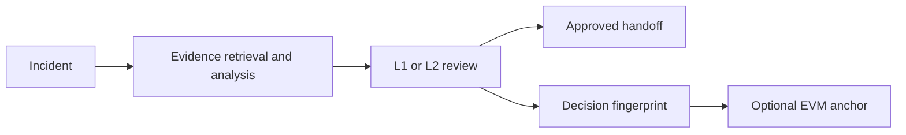

# automated-triage

AI-assisted triage for support tickets, built against a hard **3-minute
escalation window**.

The system retrieves similar incidents and runbooks, proposes a route and drafts a customer update. An L1 or L2 engineer decides what to do. Unattended tickets follow the ticketing platform's escalation policy. Decisions are stored in PostgreSQL and can be verified against a local EVM contract.

**[Hackathon walkthrough and ServiceNow setup](docs/hackathon.md)**

Two documents explain it:

- **[docs/HOW-IT-WORKS.md](docs/HOW-IT-WORKS.md)** — plain-language walkthrough of
  the original walking skeleton.
- **[docs/ARCHITECTURE.md](docs/ARCHITECTURE.md)** — the design and the reasoning
  behind the original design. The hackathon walkthrough reflects current demo behaviour.

---

## Quick start

Requires Node 22+ and Docker.

```bash
npm install
cp .env.example .env
npm run db:up        # postgres + pgvector
npm run seed         # catalog, routing memory, runbooks, templates
npm run dev          # simulator (:4000) + triage service (:3000)
```

Then in a second terminal:

```bash
npm run demo         # opens five incidents covering every policy tier
open http://localhost:3000
```

Three views:

| Route | What it is |
|---|---|
| `/` | **Overview** — did the process hold? Assigned before SLA, escalated by design, unintended escalations, median time to assign |
| `/l1` | **L1 queue** — AUTO, REVIEW and ASSIST. Approve, reroute in one click, or escalate |
| `/l2` | **L2 queue** — MANUAL only: P1, VIP/strategic, security, injection, weak downward routes |
| `/incident/INC0010001` | **Incident form** — full ServiceNow fields plus the activity stream: the work note, activity, and decision verification |

**It runs without an API key.** With `ANTHROPIC_API_KEY` unset, a deterministic
stub model stands in, so the whole pipeline — retrieval, confidence scoring,
guardrails, the deadline race, write-back — is exercised honestly and
reproducibly. Set the key to switch to Claude; nothing else changes.

For a fast demo, lower the window:

```bash
ESCALATION_WINDOW_MS=45000 AUTOCOMMIT_MARGIN_MS=15000 npm run dev
```

---

## The ticket model

Incidents use the real ServiceNow `incident` shape, so the console looks like
what an engineer already uses and the write-back path exercises the real fields:
`number` (INC0010001), `short_description`, `description`, `caller_id`,
`contact_type`, `category`, `impact`, `urgency`, `state`, `assignment_group`,
and the two journal fields — `work_notes` (internal) and `comments` (visible to
the caller).

**Priority is derived, never set directly.** The model proposes a severity; that
maps to an impact/urgency pair, and ServiceNow's standard matrix produces the
priority:

| | urgency 1 | urgency 2 | urgency 3 |
|---|---|---|---|
| **impact 1** | 1 - Critical | 2 - High | 3 - Moderate |
| **impact 2** | 2 - High | 3 - Moderate | 4 - Low |
| **impact 3** | 3 - Moderate | 4 - Low | 5 - Planning |

Three custom fields record the AI's involvement so it is reportable inside
ServiceNow itself: `u_ai_tier`, `u_ai_confidence`, `u_ai_run_id`.

---

## Workflow



L1 reviews routine and ambiguous incidents. High-risk and high-priority incidents go to L2. A missed review deadline leaves escalation to the simulator or the configured ServiceNow workflow. Customer responses are saved as drafts. In simulator mode, an approved route updates the assignment. In ServiceNow sandbox mode, an approved decision adds an internal work note.


## Design decisions worth knowing

**The model proposes; deterministic code disposes.** The model has no tools and
no write access. It returns JSON whose `recommendedTeam` is an enum built from
the *live* catalog table on every request, so it cannot name a team that does not
exist. A separate service validates against the same allow-list and performs
every write. Ticket bodies are attacker-controlled input — the worst an injection
achieves is a bad proposal, never a bad action.

**Downward routing carries a higher bar.** A wrong route *up* costs specialist
time; a wrong route *down* to L1 bounces and burns the whole window. `L1`
proposals need `CONF_DOWNWARD_L1` (0.90) rather than the normal 0.60.

**Confidence is composite, not self-reported.** The model's own number is one
input at 25% weight. Neighbour agreement — did similar past tickets actually get
resolved by this team — carries the most, because it is the only signal grounded
in what really happened.

**Routing memory is labelled by the resolving team, not the first assignment.**
Training retrieval on first-assignment teaches the model to reproduce today's
misroutes. The gap between those two labels is the value the system adds.

**Every failure path ends where you are today.** Retrieval down → catalog-only
routing. Model down → deterministic rules, flagged for a human. Model refuses →
routed to a human, never silently retried elsewhere. Write-back fails → the
ticket escalates normally. The system is strictly additive.

---

## Layout

```
data/                    versioned JSON: catalog, routing memory, runbooks, templates
db/schema.sql            tables, HNSW vector index, full-text index
docs/ARCHITECTURE.md     the design this implements

src/
  main.ts                composition root
  config/                zod-validated env; invalid config fails at boot
  core/                  pure - no I/O, no vendor types
    types.ts             the canonical Ticket model
    errors.ts            typed error hierarchy
    deadline.ts          stage budgets and timeouts
    ports/ticketing.ts   the TicketingAdapter interface
  triage/                the pipeline: enrich, redact, preclassify,
                         guardrails, confidence, policy, run-triage
  orchestration/         the human-signal-vs-timer race, and write-back
  platform/              infrastructure
    db/                  pool, migrations, repositories (all SQL lives here)
    embeddings/          EmbeddingProvider interface + local implementation
    llm/                 model gateway, schema, prompts, Claude + stub
    logging/             pino
    seed-data/           validated data-file loaders
  servicenow/            everything platform-specific, behind the port
    incident.ts          field model + priority matrix
    adapter.ts           implements core/ports/ticketing
    enrichment-sources.ts
  web/                   server + views (overview, L1/L2 queues, incident form)
  testing/               shared fixtures

tools/                   dev-only, never shipped
  simulator/             ServiceNow Table API simulator with the SLA clock
  seed.ts  demo.ts  probe-retrieval.ts  wait-for-db.mjs
```

**The dependency rule:** `core/` imports nothing else. `triage/` and
`orchestration/` depend on `core/` only. `platform/` and `servicenow/` implement
what `core/ports/` declares. Nothing under `src/` imports from `tools/`.

That is why `servicenow/` exists as its own module rather than living in
`core/`: the port speaks canonical terms (group, level, severity), and the
adapter is the only place that knows about impact, urgency and numeric incident
states. Swapping to Zendesk means writing one sibling module.

```bash
npm run check                                  # typecheck + lint + format + tests
npm test                                       # 61 tests, no database needed
npm run probe -- "stripe webhook timing out"   # inspect what retrieval returns
```

CI runs the same checks on every push and PR, plus a migrate-and-seed step
against a real pgvector service — that last one catches schema and seed-data
problems no unit test can.

The suite covers the decision logic, which is where a silent regression is most
expensive: policy tiers and the asymmetric downward bar, the guardrail
allow-list and customer-facing text rules, confidence weighting, PII
tokenisation round-trips, the derived-priority matrix, and the lexical query
builder. It is pure-unit and needs neither a database nor an API key.

---

## Honest limitations

These are deliberate for a walking skeleton, and each is isolated behind an
interface so it can be replaced without touching anything else.

- **The embedder is not semantic.** `HashedEmbeddingProvider` hashes word and
  character n-grams. It exercises the real pgvector path with no network call, so
  the system runs offline and deterministically, but it will not relate "card
  declined" to "payment failed". Replace it with a real embedding provider
  (Voyage AI is Anthropic's recommended partner), widen the `vector(256)` column
  to match, and re-seed. Only `src/infra/embeddings/` changes.
- **Orchestration is in-process.** The workflow models the timer/signal race
  correctly but lives in memory: a restart loses in-flight tickets. Production
  wants Temporal, where the timer is durable and the approval is a signal. The
  shape in `orchestrator/workflow.ts` is deliberately identical so the swap is
  mechanical.
- **No queue.** Webhook handling is direct. Kafka or SQS slots in ahead of the
  orchestrator.
- **No reconciliation poller.** Webhooks fail silently in production; the design
  calls for a poller to catch dropped deliveries. Not built yet.
- **PII redaction is illustrative.** The patterns catch common cases. Production
  needs a real detector plus a secret scanner.
- **No incident feed.** `fetchOpenIncident` returns null. A live incident is one
  of the strongest routing signals available — worth wiring early.
- **No clustering.** An incident storm currently runs the full pipeline per
  ticket. Design doc §15.3 covers fingerprinting them into one approval.
- **Unit tests only.** The decision logic is covered; the wiring is not. There
  is no integration test driving a real incident through webhook to write-back,
  so an adapter or orchestrator regression would not be caught.

---

## Next steps, in order

1. **Set `ANTHROPIC_API_KEY`** and compare routing against the stub on the demo
   scenarios. This is the first honest read on quality.
2. **Replace the embedder.** Retrieval quality is the input to routing accuracy,
   and the placeholder is the single biggest constraint on it right now.
3. **Load real historical tickets** into `data/historical-tickets.json`, labelled
   by resolving team. This matters more than any prompt tuning.
4. **Write the real ticketing adapter** once the platform is chosen — one file.
5. **Move to Temporal** before this handles production traffic.
6. **Run shadow mode** (§17 phase 0): pipeline runs, writes nothing, log
   recommendation vs. what the human actually did. That is the only honest way to
   calibrate the thresholds now sitting in `.env`.
